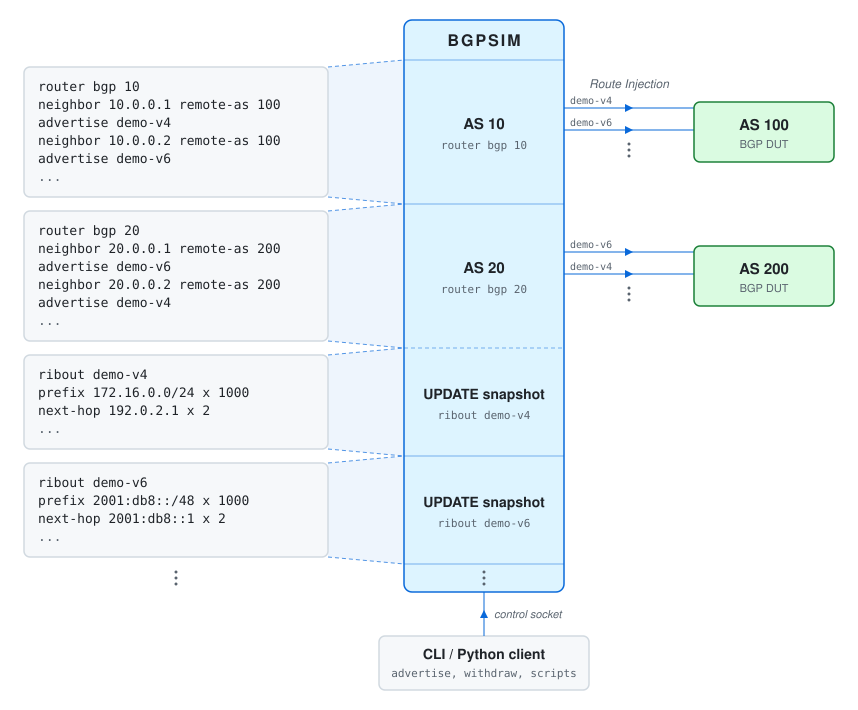

# BGP Simulator

`bgpsim` is a fast, low-overhead outbound BGP peering simulator and UPDATE
generator. It peers with real BGP speakers and sends them large and varied
UPDATE streams, for interactive tests, scale tests, and protocol-shape checks.



One process hosts one BGP instance per `router bgp` block. A `ribout` block is
a route generator. `update generate` encodes each ribout into one UPDATE
snapshot, and each neighbor sends the snapshots that its config advertises.
The CLI and the Python client drive the process over the same control socket.
One `libuv` thread runs all peer sockets, listeners, and FSM timers.

On Linux, one process can peer from several network namespaces. `vrf <name>` under
`router bgp <AS>` puts that router's sockets in an existing namespace, so peers in
the default and in non-default VRFs share one process and one event loop. bgpsim never
creates namespaces. See [VRFs](docs/configuration.md#vrfs).

`bgpsim` is not a routing stack. It has no RIB-IN, no best-path selection, and
no policy engine.

## Build

```bash
make
```

The binary is written to `/tmp/bgpsim/bgpsim`. `BUILD_DIR=<dir>` changes the
build directory and `RELEASE=1` builds with optimization. The build needs a C
compiler and `libuv`. The tests and the Python client need Python 3.

`make install` installs the binary and the Python client, with `PREFIX`,
`DESTDIR`, `BINDIR`, and `PYTHONDIR` overrides. `make dist` packs a
product-only source archive. `make help` lists all targets. See
[docs/packaging.md](docs/packaging.md) for staged installs.

## Run

```bash
$BUILD_DIR/bgpsim bgpsim.conf                   # foreground: runtime plus CLI
$BUILD_DIR/bgpsim -s lab bgpsim.conf            # server: runtime only, session "lab"
$BUILD_DIR/bgpsim -c lab                        # attach the CLI to session "lab"
$BUILD_DIR/bgpsim -c lab -e "show bgp summary"  # run one command, then exit
```

Foreground mode starts the runtime, opens the control socket, and attaches the
built-in CLI to that socket. Server mode starts the runtime only. Attach mode
connects the CLI to a running server. In attach mode, `quit` ends the attach
session and leaves the server running.

| Option | Effect |
|---|---|
| `-s [name]` | Run as a control server, with an optional session name |
| `-c [name]` | Attach to a running session |
| `-e <command>` | Run one command over the control socket, then exit |
| `-l <file>` | Write the log to this file |
| `--passive` | Also accept inbound peer connections |
| `-h`, `--help` | Show help |

The control socket is `/tmp/bgpsim.sock`, or `/tmp/bgpsim_<name>.sock` for a
named session. The default config file is `bgpsim.conf`.

## Quick Example

```text
router bgp 65001
  router-id 10.0.0.1
  neighbor 192.0.2.2 remote-as 65002
    capability route-refresh
    advertise demo-v4
!

ribout demo-v4
  prefix 10.0.0.0/24 x 100
  next-hop 192.0.2.1 x 2
  as-path 65001 65002
  med 50
  origin igp
!
```

Loading a config file encodes each ribout into an UPDATE snapshot, so no
explicit `update generate` is needed at the end of the file. When the session
is Established, the neighbor sends the snapshot, then End-of-RIB. After you edit
a ribout, run `update generate` to re-encode it, and the neighbor sends the new
snapshot. Exec commands send and withdraw snapshots on demand:

```text
bgpsim> show ribout demo-v4 preview 8
bgpsim> withdraw ribout demo-v4 peer 192.0.2.2
withdraw ribout demo-v4: queued to 192.0.2.2 (router 65001): 1 UPDATEs, 423 bytes
bgpsim> advertise ribout demo-v4 peer all
advertise ribout demo-v4: queued to 192.0.2.2 (router 65001): 2 UPDATEs, 522 bytes
```

A snapshot is sent as encoded, never re-encoded per peer. If a peer did not
negotiate what the snapshot needs (the family, ADD-PATH, 4-octet AS or its
absence, an extended next hop, or Extended Message), the snapshot is withheld
from that peer. `show bgp neighbors` shows the reason.

A neighbor also takes `hold-time`, `shutdown [<text>]`, `ttl-security hops
<n>`, `password <text>` (TCP MD5) and `capability extended-message`; see
[docs/configuration.md](docs/configuration.md).

## Exec Commands

- `show bgp summary`, `show bgp neighbors` - sessions, capabilities, TX progress
- `show running-config` - the running config
- `show ribout <name> preview <count>` - the first routes of a ribout
- `update generate [ribout <name>...]`, `update generate changed` - encode new snapshots
- `advertise ribout <name> [<scope>] peer <ip|all>` - send a snapshot now
- `withdraw ribout <name> [<scope>] peer <ip|all>` - withdraw a snapshot
- `replay ribout <name> [<scope>] peer <ip|all>` - send a snapshot again
- `withdraw all [<scope>] peer <ip|all>` - withdraw everything sent to a peer
- `run script <name> [repeat <count|forever>]`, `show runs` - timed scripts
- `clear bgp [<scope>] <neighbor|*> [cease [<text>]]` - reset sessions; `cease` sends a Cease NOTIFICATION first
- `config` - enter config mode

`<scope>` is `router <AS>` or `vrf <name|all|default>`, and `neighbor` is another
word for `peer`.

See [docs/configuration.md](docs/configuration.md) for the full syntax.

## Python Client

`src/bgpsim.py` talks to the control socket. Each connection keeps its own CLI
mode, so config commands make the same mode transitions as the interactive
CLI.

```python
from src import bgpsim

with bgpsim.connect(session="lab") as client:
    print(client.cli("show bgp summary"))
    client.cli("config")
    client.cli("ribout demo")
    client.cli("prefix 10.0.0.0/24 x 10")
    client.cli("end")
```

The same file runs one command from the shell:

```bash
python3 src/bgpsim.py -s lab "show bgp summary"
```

See [docs/python-api.md](docs/python-api.md) for the control model.

## Address Families

Ribout generates these families end to end, from config to encoded UPDATE
bytes:

- IPv4 and IPv6 unicast, and labeled-unicast
- VPNv4 and VPNv6
- EVPN Types 1-5
- SR Policy with IPv4 and IPv6 endpoints
- FlowSpec for IPv4, IPv6, and VPN
- RTC, L2VPN VPLS, and MVPN Types 1-7
- path attributes on any family: AGGREGATOR, ATOMIC_AGGREGATE,
  ORIGINATOR_ID, CLUSTER_LIST, AIGP, Only-to-Customer, the BGP Prefix-SID
  (Label-Index, SRv6 L3 and L2 service SIDs), and any other attribute as hex
- AS paths with sets and confederation segments, and, for a session without
  4-octet AS numbers, the 2-octet form with AS4_PATH and AS4_AGGREGATOR
- extended communities: route targets and Site of Origin on any family, Link
  Bandwidth, EVPN MAC Mobility and Default Gateway, and any other as hex
- UPDATEs of up to 65535 octets (Extended Message, RFC 8654)
- BGP-LS
  - NLRIs: node, link, IPv4 and IPv6 prefix, SRv6 SID, SR Policy candidate
    path
  - topologies: IGP (IS-IS, OSPF) and BGP peering (EPE)
  - named attribute TLVs: TE, SR-MPLS, SRv6, Flexible Algorithm, BGP peering
    SIDs, SR Policy state

ADD-PATH and extended next hop apply where the family permits them. See
[docs/address-families.md](docs/address-families.md) for the matrix and
[docs/bgp-update-api.md](docs/bgp-update-api.md) for the low-level encoder.

## Documentation

- Configuration
  - [configuration.md](docs/configuration.md): the config file, the parser,
    router and neighbor configuration
  - [ribout-configuration.md](docs/ribout-configuration.md): ribout blocks
    and the tokens every family shares
  - [sending-updates.md](docs/sending-updates.md): snapshots, the send
    commands, standing advertisements, scripts and runs
  - [logging.md](docs/logging.md): log file layout and behavior
- Address families
  - [address-families.md](docs/address-families.md): the support matrix for
    OPEN, neighbor config, UPDATE encoding and ribout
  - [ribout-evpn.md](docs/ribout-evpn.md): EVPN
  - [ribout-sr-policy.md](docs/ribout-sr-policy.md): SR Policy
  - [ribout-flowspec.md](docs/ribout-flowspec.md): FlowSpec
  - [ribout-templates.md](docs/ribout-templates.md): RTC, VPLS and MVPN
    templates
  - [bgp-ls.md](docs/bgp-ls.md): BGP-LS
- Design
  - [bgp-fsm.md](docs/bgp-fsm.md): the session FSM, timers and OPEN handling
  - [bgp-ribout.md](docs/bgp-ribout.md): the ribout generation, rotation,
    grouping and packing model
  - [bgp-tx.md](docs/bgp-tx.md): the outbound TX and script run design
- APIs
  - [python-api.md](docs/python-api.md): the Python control client and the
    control protocol
  - [bgp-update-api.md](docs/bgp-update-api.md): the low-level UPDATE encoder
- Development
  - [testing.md](docs/testing.md): the test harness, profiles and benchmarks
    (`make unit-test`, `make all-test`, `make bench`)
  - [packaging.md](docs/packaging.md): staged installs and the source archive
  - [docs/todo/](docs/todo/): design notes and open follow-ups
