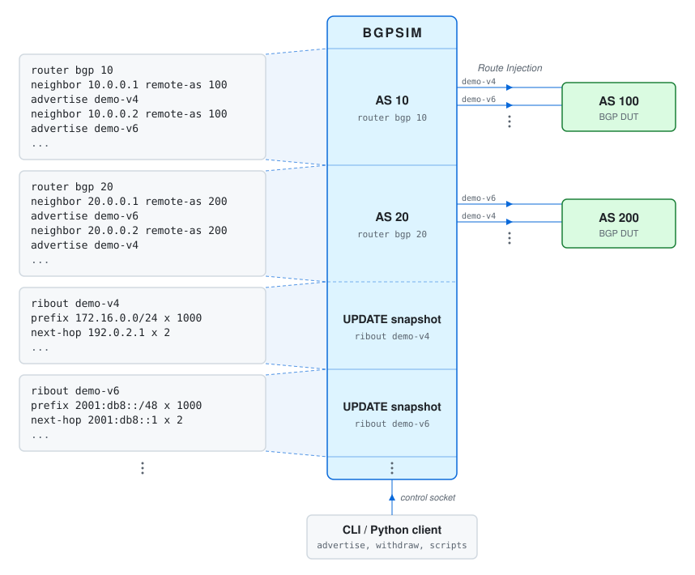

# BGP Simulator

`bgpsim` is a fast, low-overhead outbound BGP peering simulator and UPDATE
generator. It peers with real BGP speakers and sends them large and varied
UPDATE streams, for interactive tests, scale tests, and protocol-shape checks.



One process hosts one BGP instance per `router bgp` block. A `ribout` block is
a route generator. `update generate` encodes each ribout into one UPDATE
snapshot, and each neighbor sends the snapshots that its config advertises.
The CLI and the Python client drive the process over the same control socket.
One `libuv` thread runs all peer sockets, listeners, and FSM timers.

`bgpsim` is not a routing stack. It has no RIB-IN, no best-path selection, and
no policy engine.

## Build

```bash
make
```

The binary is written to `/tmp/bgpsim/bgpsim`. `BUILD_DIR=<dir>` changes the
build directory and `RELEASE=1` builds with optimization. The build needs a C
compiler and `libuv`. The tests and the Python client need Python 3.

`make install` installs the binary and the Python client, with `PREFIX`,
`DESTDIR`, `BINDIR`, and `PYTHONDIR` overrides. `make dist` packs a
product-only source archive. `make help` lists all targets. See
[docs/packaging.md](docs/packaging.md) for staged installs.

## Run

```bash
$BUILD_DIR/bgpsim bgpsim.conf                   # foreground: runtime plus CLI
$BUILD_DIR/bgpsim -s lab bgpsim.conf            # server: runtime only, session "lab"
$BUILD_DIR/bgpsim -c lab                        # attach the CLI to session "lab"
$BUILD_DIR/bgpsim -c lab -e "show bgp summary"  # run one command, then exit
```

Foreground mode starts the runtime, opens the control socket, and attaches the
built-in CLI to that socket. Server mode starts the runtime only. Attach mode
connects the CLI to a running server. In attach mode, `quit` ends the attach
session and leaves the server running.

| Option | Effect |
|---|---|
| `-s [name]` | Run as a control server, with an optional session name |
| `-c [name]` | Attach to a running session |
| `-e <command>` | Run one command over the control socket, then exit |
| `-l <file>` | Write the log to this file |
| `--passive` | Also accept inbound peer connections |
| `-h`, `--help` | Show help |

The control socket is `/tmp/bgpsim.sock`, or `/tmp/bgpsim_<name>.sock` for a
named session. The default config file is `bgpsim.conf`.

## Quick Example

```text
router bgp 65001
  router-id 10.0.0.1
  neighbor 192.0.2.2 remote-as 65002
    capability route-refresh
    advertise demo-v4
!

ribout demo-v4
  prefix 10.0.0.0/24 x 100
  next-hop 192.0.2.1 x 2
  as-path 65001 65002
  med 50
  origin igp
!

update generate
```

`update generate` encodes the ribout into an UPDATE snapshot. When the session
is Established, the neighbor sends the snapshot, then End-of-RIB. After each
new `update generate`, the neighbor sends the new snapshot. Exec commands send
and withdraw snapshots on demand:

```text
bgpsim> show ribout demo-v4 preview 8
bgpsim> withdraw ribout demo-v4 peer 192.0.2.2
withdraw ribout demo-v4: queued to 192.0.2.2 (router 65001): 1 UPDATEs, 423 bytes
bgpsim> advertise ribout demo-v4 peer all
advertise ribout demo-v4: queued to 192.0.2.2 (router 65001): 2 UPDATEs, 522 bytes
```

A snapshot is sent as encoded, never re-encoded per peer. If a peer did not
negotiate what the snapshot needs (the family, ADD-PATH, 4-octet AS, or an
extended next hop), the snapshot is withheld from that peer. `show bgp
neighbors` shows the reason.

## Exec Commands

- `show bgp summary`, `show bgp neighbors` - sessions, capabilities, TX progress
- `show running-config` - the running config
- `show ribout <name> preview <count>` - the first routes of a ribout
- `update generate [ribout <name>...]`, `update generate changed` - encode new snapshots
- `advertise ribout <name> peer <ip|all> [router <AS>]` - send a snapshot now
- `withdraw ribout <name> peer <ip|all> [router <AS>]` - withdraw a snapshot
- `replay ribout <name> peer <ip|all> [router <AS>]` - send a snapshot again
- `withdraw all peer <ip|all> [router <AS>]` - withdraw everything sent to a peer
- `run script <name> [repeat <count|forever>]`, `show runs` - timed scripts
- `clear bgp <neighbor>` - reset a session
- `config` - enter config mode

See [docs/configuration.md](docs/configuration.md) for the full syntax.

## Python Client

`src/bgpsim.py` talks to the control socket. Each connection keeps its own CLI
mode, so config commands make the same mode transitions as the interactive
CLI.

```python
from src import bgpsim

with bgpsim.connect(session="lab") as client:
    print(client.cli("show bgp summary"))
    client.cli("config")
    client.cli("ribout demo")
    client.cli("prefix 10.0.0.0/24 x 10")
    client.cli("end")
```

The same file runs one command from the shell:

```bash
python3 src/bgpsim.py -s lab "show bgp summary"
```

See [docs/python-api.md](docs/python-api.md) for the control model.

## Address Families

Ribout generates these families end to end, from config to encoded UPDATE
bytes:

- IPv4 and IPv6 unicast, and labeled-unicast
- VPNv4 and VPNv6
- EVPN Types 1-5
- SR Policy with IPv4 and IPv6 endpoints
- FlowSpec for IPv4, IPv6, and VPN
- RTC, L2VPN VPLS, and MVPN Types 1-7
- BGP-LS node, link, IPv4-prefix, and IPv6-prefix NLRIs

ADD-PATH and extended next hop apply where the family permits them. See
[docs/address-families.md](docs/address-families.md) for the matrix and
[docs/bgp-update-api.md](docs/bgp-update-api.md) for the low-level encoder.

## Documentation

- [docs/configuration.md](docs/configuration.md): config and exec command
  reference, ribout tokens, sending UPDATEs, scripts
- [docs/bgp-ribout.md](docs/bgp-ribout.md): the ribout generation, rotation,
  grouping, and packing model
- [docs/address-families.md](docs/address-families.md): per-family support
  matrix for OPEN, neighbor config, UPDATE encoding, and ribout
- [docs/bgp-update-api.md](docs/bgp-update-api.md): the low-level UPDATE
  encoder API
- [docs/bgp-fsm.md](docs/bgp-fsm.md): the session FSM, timers, and OPEN
  handling
- [docs/python-api.md](docs/python-api.md): the Python control client and
  the control protocol
- [docs/logging.md](docs/logging.md): log file layout and behavior
- [docs/testing.md](docs/testing.md): the test harness, profiles, and
  benchmarks (`make unit-test`, `make all-test`, `make bench`)
- [docs/packaging.md](docs/packaging.md): staged installs and the source
  archive
- [docs/todo/](docs/todo/): design notes and open follow-ups
